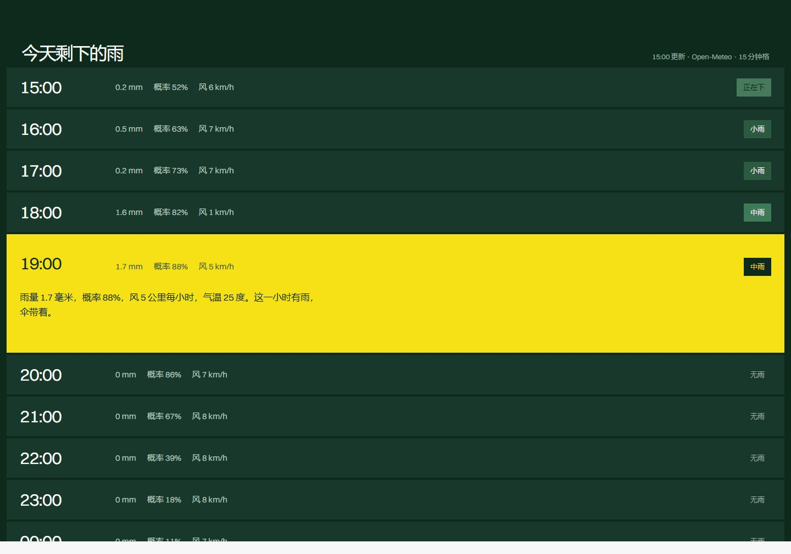

# 下一班雨 · design-taste-frontend on DeepSeek Harness

一个用来验证「用 [taste-skill](https://github.com/Leonxlnx/taste-skill) 的 `design-taste-frontend` 做前端」到底能做出什么的演示项目：
广州三个区的 15 分钟降水预报，被排成一张「发车时刻表」——几点下雨、几点停、要不要带伞。

页面上的每个数字都来自 [Open-Meteo](https://open-meteo.com/) 的真实预报响应（`data/gz-*.json`），
由 `build-data.mjs` 整理成 `app-data.js`，页面不联网也能看。


## 这个项目包含什么

| 路径 | 说明 |
| --- | --- |
| `index.html` · `styles.css` · `app.js` | 页面本体：结构、样式、交互（切区、时刻表展开、滚动揭示） |
| `app-data.js` | 由 `build-data.mjs` 生成的数据文件（勿手改） |
| `build-data.mjs` | 读取 `data/` 下的预报响应，整理成窗口表与逐时表 |
| `data/` | 三个坐标（天河、越秀、海珠）的 Open-Meteo 原始响应，可复核 |
| `assets/` | 四张历史图片、本地化的 Switzer 字体、图片许可记录 |
| `shots/` | 文档与 README 用到的截图（含检查器输出的终端渲染） |
| `docs/` | 分享文档：`deepseek-harness-taste-skill.pdf` / `.docx` |
| `capture.mjs` · `shot.mjs` · `shots3.mjs` · `term-shots.mjs` | 截图脚本（本机 Edge 无头模式 + CDP） |
| `build-doc.py` · `make-term.py` | 分享文档的生成与校验脚本 |

## 本地运行

不需要构建，也不需要框架：

```bash
# 直接打开
start index.html

# 或者起一个静态服务（推荐，字体与图片走 http 更稳）
npx serve .
```

## 重新取数

```bash
node build-data.mjs   # 读取 data/gz-*.json，重新生成 app-data.js
```

换城市就把 `build-data.mjs` 顶部的 `DISTRICTS` 换成新的坐标与文件名，并同步更新 `data/`。

## 页面是怎么定下来的

用 `design-taste-frontend` 的流程做的，方向由脚本发牌而不是自由发挥：

- 方向：`product-performs`（seed `394207075`），字体 Switzer，配色 Bottle ink + Yellow
- 检查：`lint.mjs` 0 FAIL；`inspect.mjs` 在 1440 / 768 / 390 三个宽度上 **0 FAIL / 1 WARN**（唯一 WARN 是页面没有视频：本次环境里 Wikimedia、Internet Archive 的视频检索均不可达，改用一张缓慢漂移的历史照片作为「会动的画面」）
- 过程记录（含被检查器拦下的 6 个 FAIL 和改法）在 `docs/deepseek-harness-taste-skill.pdf`



## 图片与许可

四张历史图片均为大都会艺术博物馆 Open Access 藏品，公有领域（CC0），页面上与本文档中均已署名：

| 作品 | 作者 / 年代 | 出处 |
| --- | --- | --- |
| 《御茶之水之雨》 | 歌川国芳，19 世纪中叶 | [The Met 51084](https://www.metmuseum.org/art/collection/search/51084) |
| 美国制伞（兽首伞柄） | 美国制，1888 年 | [The Met 158043](https://www.metmuseum.org/art/collection/search/158043) |
| Street in Kadhin; Shanghai | 约翰·汤普森，约 1869 年 | [The Met 289373](https://www.metmuseum.org/art/collection/search/289373) |
| [Broadway in the Rain] | 爱德华·安东尼，约 1860 年代 | [The Met 262762](https://www.metmuseum.org/art/collection/search/262762) |

字体 Switzer 由 Fontshare 提供，已本地化到 `assets/fonts/`（SIL Open Font License）。

## 说明

「下一班雨」是一个演示品牌：城市、街道、降水数字是真实的，品牌名与按钮去处需要换成真实信息才能上线。
